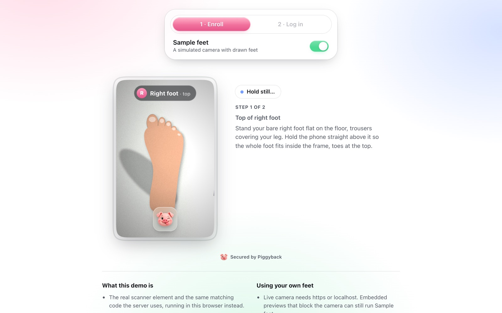
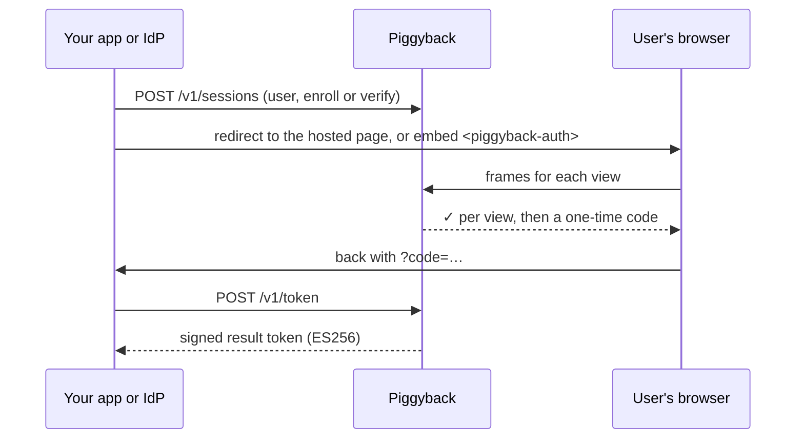
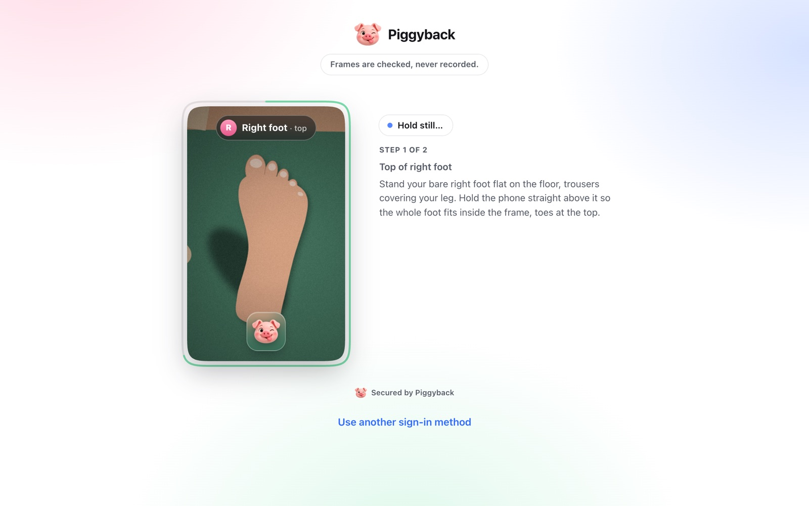
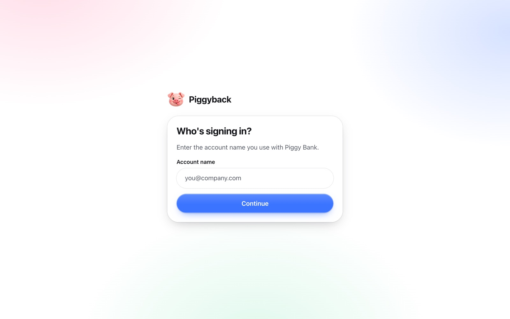
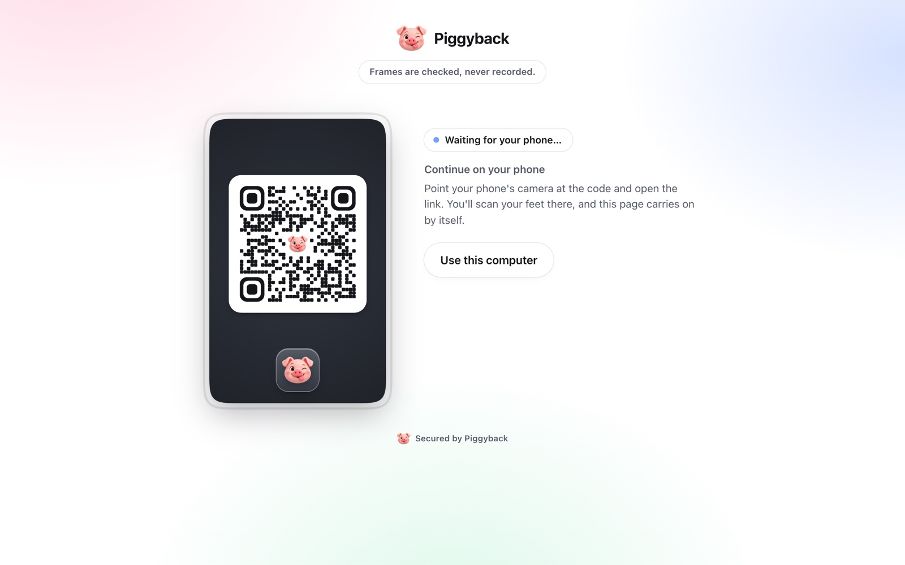
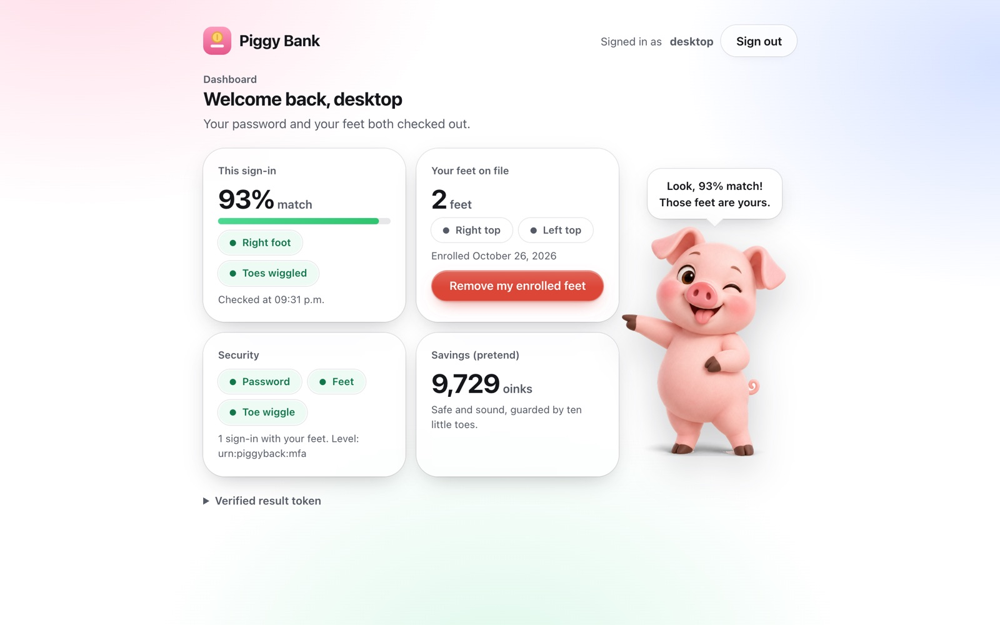
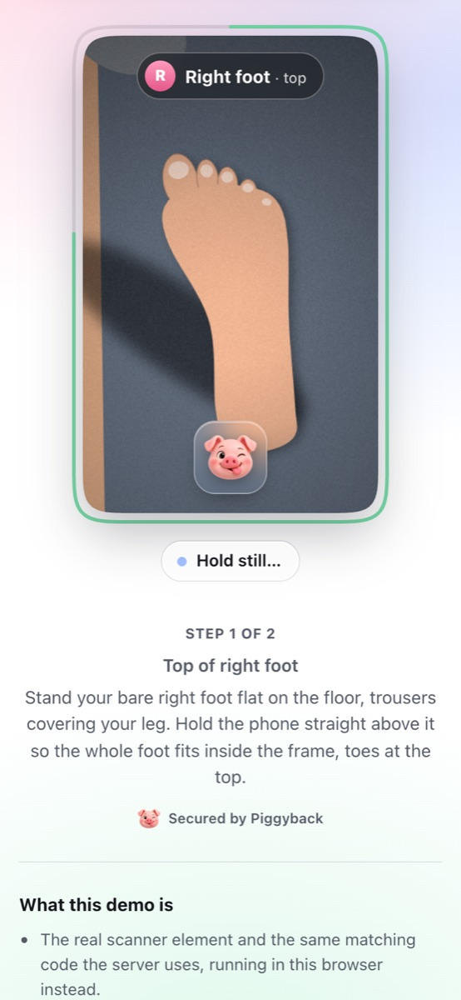
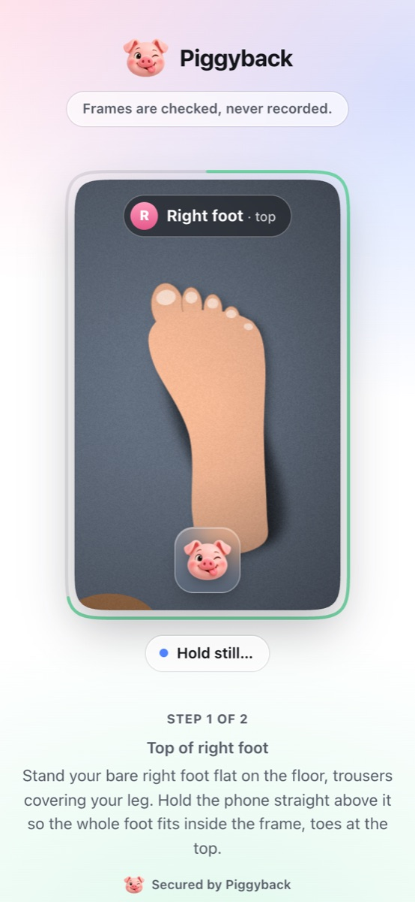
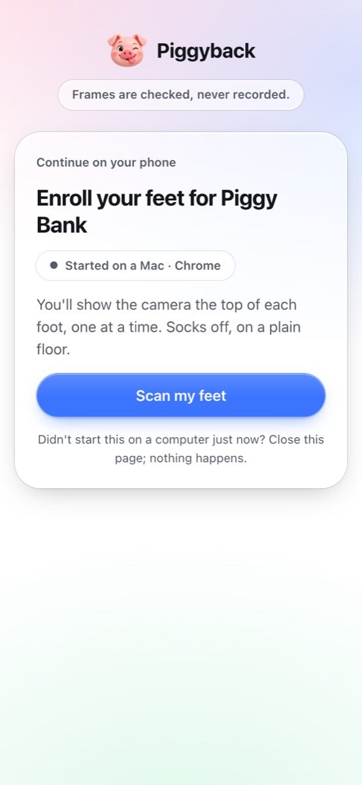
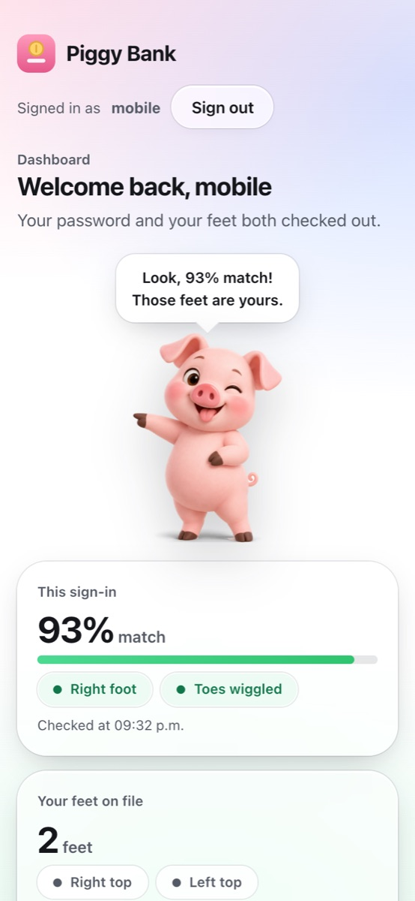

<p align="center">
  
</p>

<h1 align="center">Piggyback</h1>

<p align="center">
  <b>The new 2FA (Two-Feet Authentication).</b><br>
  A second factor that scans your feet, checks for a toe wiggle,<br>
  and piggybacks on the login you already have.
</p>

<p align="center">
  
  
  
  
</p>

<p align="center">
  <a href="#quickstart">Quickstart</a> ·
  <a href="docs/DEPLOY.md">Deploy</a> ·
  <a href="#add-it-to-your-login">Integrate</a> ·
  <a href="docs/INTEGRATION.md">Integration guide</a> ·
  <a href="docs/INTEGRATION.md#api-reference">API</a> ·
  <a href="brand/BRAND.md">Brand</a>
</p>

<p align="center">
  
</p>

## How it works

1. **Enroll once.** The top of each foot from three places: straight above, tilted towards you, tilted outwards, each held still for a second. A login is matched against the closest of them. After each foot you see what was saved and can redo it.
2. **Log in.** The server picks one foot at random. Show it; once it matches, keep your heel down and wiggle your toes. Not knowing which foot means nobody can prepare the right one, and a photo can't wiggle: however it's tilted, zoomed or lit, it changes as one flat picture, and a finger over the toes is caught crossing the floor around them.
3. **On a computer, it hands off to the phone.** A laptop webcam can't see feet, so the scanner shows a QR code; the phone scans, the computer finishes by itself. No app to install, and the user's next step (like the first login after enrolling) goes straight to the same phone.
4. **The server decides.** The browser only sends frames. Matching and liveness run on the server, which hands your backend a signed, one-time result.



## Quickstart

```bash
git clone https://github.com/felixgonthier/two-feet-auth.git && cd two-feet-auth
npm start                                    # service on http://localhost:8787
```

In a second terminal, register the example app and start it:

```bash
node server/cli.js add-client --name "Demo" --redirect-uri http://localhost:3000/mfa/callback
CLIENT_ID=pb_… CLIENT_SECRET=… npm run demo   # Piggy Bank on http://localhost:3000
```

Open <http://localhost:3000/?sample=you>, sign in with any name and the password `demo`. On a computer, choose **Use this computer**, or scan the QR code with your phone once the service has an https address it can reach ([phone handoff setup](docs/INTEGRATION.md#on-a-computer-continue-on-the-phone)). Drawn sample feet stand in for a camera; try `?sample=impostor` or `?sample=photo` to watch it refuse. Drop `?sample` to use your real camera (localhost or https).

**Run it for real** with Docker and automatic https: set a domain and a key in `.env`, then `docker compose up -d`. The image is `ghcr.io/felixgonthier/two-feet-auth`; the [deployment guide](docs/DEPLOY.md) covers Docker and plain Linux servers, registering apps, updates and backups.

**No server?** `npm run build:demo` writes the whole demo to one HTML file in `dist/` that opens straight from disk. It runs the real element and the real decision code in the browser, for trying it out, not for real logins. With Sample feet on, "Use my phone" shows a simulated phone in the page.

## Add it to your login

| | How | Good for |
|---|---|---|
| **Redirect** | Create a session, send the user to `hosted_url`, swap the returned `code` for a result token. | Any stack. Like Duo's prompt. |
| **Embedded** | Drop `<piggyback-auth>` into your own page and listen for `piggyback-complete`. | Keeping users on your page. |
| **Identity platform** | Point it at `/.well-known/openid-configuration`. Code flow with PKCE, `form_post`, `login_hint` or a signed `id_token_hint`. | Okta, Entra ID, Ping, Keycloak, Auth0. |

```js
// Redirect: start a session, then verify what comes back.
const s = await feet.post("/v1/sessions", { user_id, purpose: "verify", redirect_uri, state });
res.redirect(s.hosted_url);
// on your redirect_uri
const { result_token } = await feet.post("/v1/token", { code });   // check iss, aud, sub, amr against the JWKS
```

```html
<!-- Embedded -->
<script type="module" src="https://feet.example.com/sdk/piggyback.js"></script>
<piggyback-auth server="https://feet.example.com" session-token="…"></piggyback-auth>
```

Step-by-step setup, token checks, per-platform recipes and the full API are in the [integration guide](docs/INTEGRATION.md).

## Screens

Every screen is built from one small UI kit in [`ui/`](ui): frosted glass on a soft wash of pink, blue and green.

<table>
  <tr>
    <td width="50%"></td>
    <td width="50%"></td>
  </tr>
  <tr>
    <td align="center"><sub><b>Hosted page</b> · for redirect integrations</sub></td>
    <td align="center"><sub><b>Sign-in prompt</b> · when a platform doesn't name the user</sub></td>
  </tr>
  <tr>
    <td width="50%"></td>
    <td width="50%"></td>
  </tr>
  <tr>
    <td align="center"><sub><b>Continue on your phone</b> · the computer shows a code</sub></td>
    <td align="center"><sub><b>Piggy Bank</b> · the example app, after password + feet</sub></td>
  </tr>
</table>

<table>
  <tr>
    <td width="25%"></td>
    <td width="25%"></td>
    <td width="25%"></td>
    <td width="25%"></td>
  </tr>
  <tr>
    <td align="center"><sub>Demo</sub></td>
    <td align="center"><sub>Hosted page</sub></td>
    <td align="center"><sub>Phone, from the QR code</sub></td>
    <td align="center"><sub>Piggy Bank</sub></td>
  </tr>
</table>

## What's inside

| | |
|---|---|
| [`server/`](server) | The verification service: sessions, matching, toe-wiggle liveness, encrypted template storage, signed tokens, the phone handoff and the OpenID Connect provider. Short-lived state in memory or Redis. Node 20+, zero dependencies. |
| [`sdk/`](sdk) | `<piggyback-auth>`, the drop-in scanner, plus the hosted page, the phone page and an in-browser backend for demos. |
| [`core/`](core) | The shared engine: foot detection, measurements, matching and toe motion, used in the browser for guidance and on the server for decisions. Plus FootNet, a 145-number foot model, and a small QR encoder. |
| [`ui/`](ui) | `tokens.css`, `controls.css`, `page.css`: the colours, controls, panels, chips and toasts every screen shares. |
| [`demo/`](demo) · [`examples/`](examples) | The no-server demo, and "Piggy Bank", a stand-in app wired both ways. |
| [`brand/`](brand) | The pig, and the [brand guide](brand/BRAND.md). |
| [`deploy/`](deploy) · `Dockerfile` | Docker Compose with automatic https, and systemd and Caddy files for plain servers. See the [deployment guide](docs/DEPLOY.md). |

## Privacy and security

- Frames are analysed in memory and dropped. Only measurements are kept: 388 numbers per frame, AES-256-GCM encrypted and bound to the app and the user.
- Every decision is made on the server; match scores never reach the browser.
- Sessions last 10 minutes, codes 60 seconds, tokens 5 minutes, phone links 2 minutes (single use); 5 tries per view.
- Foot templates are biometric data. Get opt-in consent, honour deletion (`DELETE /v1/users/:id`), and check local law (PIPEDA and Quebec's Law 25 in Canada, BIPA in Illinois).

## Tests

```bash
npm test                          # 17 API, OpenID Connect and shared-state checks
npm install && npm run test:e2e   # 21 browser checks (needs Chrome)
PIGGYBACK_TEST_REDIS_URL=redis://localhost:6379 npm test   # also runs the shared-state checks on Redis
```

The browser suite enrolls and verifies through both integrations, hands off from a computer to a phone and keeps the same phone for the next step, refuses an impostor and a photo, deletes a user, and drives two stand-in identity platforms through OpenID Connect, including a forged hint and the cancel path.

## Status

**Prototype.** Matching is tuned on drawn sample feet and on a handful of real scans from two people (the scanner's `?debug` mode saves what it saw; `node scripts/eval-scans.mjs scan.json …` replays saved scans through the engine and scores every session against every other). A recorded video of wiggling toes would pass the liveness check. Sessions live in memory unless you point `PIGGYBACK_REDIS_URL` at Redis to run several instances. The identity platform recipes follow each vendor's documented model but haven't been run against a live tenant. See [Before production](docs/INTEGRATION.md#before-production).
